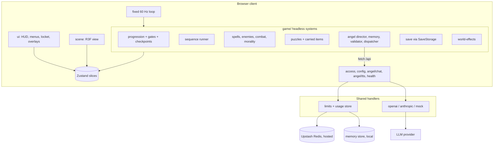

# Design Document

## Overview
This design implements `requirements.md`. The full system architecture is in `ARCHITECTURE.md` (included below). Detailed contracts and content specs live in `docs/`. This file adds the component map, data flows, error handling, correctness properties and the testing approach.

#[[file:.kiro/specs/the-last-house/ARCHITECTURE.md]]

Supporting specs:
#[[file:.kiro/specs/the-last-house/docs/contracts.md]]
#[[file:.kiro/specs/the-last-house/docs/cinematic-controller.md]]
#[[file:.kiro/specs/the-last-house/docs/level-manifest.md]]
#[[file:.kiro/specs/the-last-house/docs/combat-tuning.md]]

Also: `docs/beat-sheet.md`, `docs/puzzles.md`, `docs/input-ux.md`, `docs/angel-technical.md`, `docs/angel-persona.md`, `docs/side-quests.md`, `docs/hosting-ops.md`, `docs/asset-manifest.md`, `docs/asset-conventions.md`, `docs/script/`.

## Architecture summary

## Components and interfaces
| Component | Location | Key interface | Requirements |
|---|---|---|---|
| Input and pointer lock | `game/input.ts` | `InputState`, `PointerLockMachine` | 4 |
| Player and hands | `game/player.ts`, `scene/hands.tsx` | `stepPlayer(state, input, dt)` | 4 |
| World registry | `game/world-registry.ts`, `content/world/` | `WorldEntity`, `validateRegistry()` | 1, 12, 19 |
| Progression | `game/progression.ts`, `content/flags.ts`, `content/beats.ts` | `setFlag()`, `knowledgeLevel(flags)`, `evaluateGates()` | 1, 2, 8 |
| Sequence runner | `game/sequences.ts`, `content/sequences/` | `SequenceDef`, `runSequence()`, `skip()` | 3 |
| Spells | `game/spells.ts` | `SpellConfig`, `castState` | 5 |
| Enemies and combat | `game/enemies.ts`, `game/combat.ts` | FSM + abilities, `applyHit()` with stun floor | 6 |
| Morality | `game/morality.ts` | `applyDelta()`, `band(value)` | 9 |
| Puzzles and items | `game/puzzles.ts`, `game/carried-items.ts`, `content/puzzles/` | `PuzzleMachine`, `hintLevel` | 7 |
| Finale | `game/finale.ts` | seal state table, anchor machines, smoke director | 8 |
| Dialogue (Classic) | `game/dialogue.ts`, `content/dialogue/` | `selectClassicLine(ctx)` | 10, 14 |
| Angel director | `game/angel/director.ts` | `respond(text)`, `aiStatus` | 11, 14 |
| Angel memory | `game/angel/memory.ts` | `buildSnapshot()`, `summarise(eventLog)` | 11 |
| Action validator and dispatcher | `game/angel/action-validator.ts`, `action-dispatcher.ts`, `story-safety.ts` | `validateAngelAction()`, `AngelEffectApi` | 12 |
| Side quests and glitches | `game/angel/side-quests.ts`, `glitch-scheduler.ts` | template registry, scheduler | 13 |
| Saves | `game/save.ts`, `services/local-storage-save.ts` | `SaveStorage`, `SaveFileV1`, migrations | 15 |
| Audio | `services/audio.ts`, `game/audio-logic.ts` | buses, cue IDs, VO by line ID | 18 |
| Shared schemas | `packages/shared/src/` | zod schemas for API, save, actions | 11, 12, 15, 16, 17 |
| Handlers | `apps/server/src/handlers/` | `health`, `status`, `redeem`, `configLlm`, `chat`, `tts` | 16, 17 |
| Limits and usage store | `apps/server/src/limits/`, `store/` | `UsageStore` (Upstash, memory) | 16 |
| LLM adapters | `apps/server/src/llm/` | `LlmAdapter`, structured-output chain | 17 |
| Prompt builder and canon filter | `apps/server/src/llm/prompt.ts`, `canon-filter.ts` | `buildPrompt(snapshot, ...)` | 11 |
| Vercel entry points | `/api/*.ts`, `vercel.json` | thin wrappers | 16 |
| Local server and dev runner | `apps/server/src/local.ts`, `scripts/dev.mjs` | `npm run dev` | 17, 21 |
| Repo checks | `scripts/check-*.mjs`, `tools/check-assets.mjs` | secret scan, README/env sync, asset check | 19, 21, 22 |

## Data flows
1. **Beat progression**: interaction or trigger -> progression sets flag -> gates re-evaluated -> checkpoint written -> autosave -> objective updated -> knowledge level updated.
2. **Purify or destroy**: hit -> stun floor -> stunned -> player chooses -> outcome -> morality delta -> drop or release clue -> flag.
3. **AI chat**: T -> locket -> request -> server checks limits -> prompt -> adapter -> zod -> canon filter -> usage recorded -> response -> speech shown -> proposals queued -> locket closes -> re-validate -> apply via `AngelEffectApi` -> event log.
4. **Fallback**: error code -> `aiStatus` mapping -> Classic line for this turn -> retry policy.
5. **Save**: checkpoint -> serialise slices + hot-data snapshot -> zod validate -> `SaveStorage.save('tlh.save')`.

## Error handling
| Situation | Handling | Requirement |
|---|---|---|
| Pointer lock refused | Overlay, retry on click only | 4.3 |
| Asset missing | Greybox fallback, console warning in dev | 19.2 |
| VO missing | Subtitle only | 18.2 |
| Corrupt or newer save | Message, offer New Game | 15.4 |
| Sequence interrupted | Roll back to sequence start | 3.5 |
| Server error codes | `contracts.md` section 3 mapping | 14.1 |
| Provider refusal | Stock line, stay ready | 11, 14 |
| Invalid LLM output | One repair retry, then stock line | 17.4 |
| Redis unavailable | Fail closed, Classic | 16.7 |
| Validator exception | Treated as rejection, no state change | 12.7 |

## Correctness properties
Each property is checked by an automated test (unit, property via seeded loops, or content test). The first column links to `docs/contracts.md` section 9.
| # | Property | Test type | Requirements |
|---|---|---|---|
| P1 | Morality stays within [-100, 100] for any event sequence | seeded property | 9.1 |
| P2 | Any sequence of validated Angel actions leaves the critical path and the good ending reachable from every checkpoint | seeded property (1,000 runs) | 12, 8.7 |
| P3 | Rejected proposals change no state | unit, table-driven | 12.7 |
| P4 | save -> load -> save is identical | unit | 15 |
| P5 | Serialised saves contain no key-like patterns | unit | 15.7, 22 |
| P6 | Side quests offered <= 2, active <= 1 | seeded property | 13.1 |
| P7 | Mode switches and fallback never change flags, world state or morality | unit + integration | 14.3 |
| P8 | The ending is a pure function of the confirmed choice | unit | 8.7 |
| P9 | Gates open only from critical-path flags; no `angelUnlock` entity is critical | content test | 1.4, 12.4 |
| P10 | Both outcomes of each mini-boss lead to the same next critical-path flag | unit | 6.6 |
| P11 | Forced-control total per playthrough <= 180 s | content test | 3.6 |
| P12 | Hosted handlers reject client-supplied base URLs and keys | server unit | 16.8, 17.7 |
| P13 | Both endings are reachable from every checkpoint in Classic Mode with no network | headless integration | 1, 10.4 |
| P14 | Skipping a cinematic at any step yields the same flags and world state as finishing it | unit | 3.4 |
| P15 | The Angel's prompt never contains facts above the snapshot's knowledge level | golden prompt test | 11.4 |
| P16 | The stun floor makes it impossible to destroy a stunned enemy without a charged Bolt | unit | 5.6, 6.3 |

## Testing strategy
- **Unit (Vitest, `vitest --run`)**: every system in `game/`, schemas, handlers, adapters with recorded fixtures.
- **Property**: seeded PRNG loops (no `fast-check` dependency), seeds printed on failure.
- **Content**: one suite validating `content/` against the manifests, flags, sequences, budgets and line IDs.
- **Headless integration**: scripted Classic playthroughs to each ending; AI mode with `MockAdapter` including failure and recovery.
- **Server**: redeem, cookies, quotas, concurrency, ceiling, fail closed, redaction, BYOK rejection in hosted mode.
- **Browser (Playwright)**: boot, warning, menu, Classic start, locket open and close, save and load round trip.
- **Manual**: pacing (25-30 min), scares, audio mix, performance presets, hosted checklist (`docs/hosting-ops.md` section 8), fresh-clone setup from the README.

## Decisions requiring approval (from this design)
| Item | Default |
|---|---|
| `@gltf-transform/cli` dev dependency for GLB optimisation | Needed for `tools/optimize-glb.mjs`; approve in Phase A |
| Seq 4 interactive dialogue excluded from the forced-control budget | Excluded, capped at 120 s |
| Talking board answer `KEEPER` and padlock code `1966` | As drafted |
| Watcher's purified lore line | As drafted, pending approval |